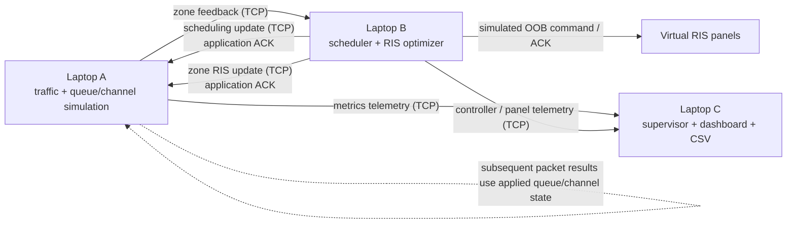

# Laptop A/B/C Architecture

## Runtime boundaries

- Laptop A generates logical traffic, serves queues, evaluates packet delivery in
  a software channel model, emits per-zone feedback, and applies validated
  scheduling/RIS updates from B.
- Laptop B consumes A feedback, calculates scheduling weights and candidate RIS
  codebooks, and sends a zone update only after its simulated OOB panel commands
  acknowledge. It applies its local panel state only after A acknowledges the
  application update.
- Laptop C reconciles A/B telemetry for monitoring and CSV export.
- Laptop-to-laptop control and telemetry use TCP. RIS propagation and OOB radio
  behavior are software simulations; no RF hardware is controlled or measured.

## Control-cycle invariant

An adaptive zone update is applied to all B virtual panels in that zone only
after each simulated OOB command succeeds and A acknowledges the complete zone
update. A validates every panel and version before mutating panel state, and
keeps each panel's version independently. The predicted SINR delta is a
simulated channel-model result and is applied to A's simulated zone channel for
subsequent packet evaluations.
